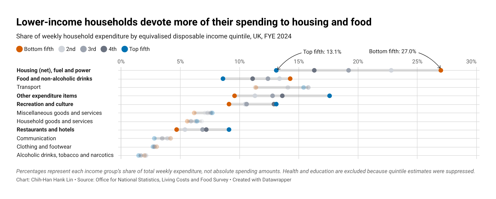

| [Home](https://hanklin999.github.io/tswd-portfolio/) | [Data Visualization Examples](dataviz-examples) | [Critique by Design](critique-by-design) | [Final Project I](final-project-part-one) | [Final Project II](final-project-part-two) | [Final Project III](final-project-part-three) |

# Critique by Design

> **Status: In progress.** Steps one through three are complete. The prototype will be tested during the in-class critique before the final redesign is published.

## Family spending across income quintiles

This project critiques and redesigns a visualization of household spending patterns across income quintiles in the United Kingdom. The goal is to make the differences between lower- and higher-income households easier to compare without implying that percentages with different denominators can be added together.

## Step one: the visualization

I selected MakeoverMonday's [2025/W39 Family Spending in the UK](https://makeovermonday.vercel.app/dataset/2025w39-family-spending-in-the-uk). The visualization uses data from the UK Office for National Statistics (ONS) to compare the percentage of weekly household expenditure assigned to different categories across five equivalised disposable income quintiles.

I chose this visualization because the topic is socially meaningful and relevant to readers interested in household spending, inequality, and public policy. The original chart has a clean appearance and a reliable source, but its stacked-bar design makes the income groups difficult to compare. Each segment represents a percentage calculated from a different income group's total expenditure, so the combined length of a bar has no meaningful interpretation. In addition, “All households” includes the five quintiles but is presented as another segment.

## Step two: the critique

I evaluated the original visualization using Stephen Few's *Data Visualization Effectiveness Profile*. The chart performs reasonably well in usefulness and aesthetics: the topic is important, the expenditure categories are recognizable, the source is clear, and the design avoids unnecessary decoration. It also allows readers to notice that spending patterns vary across income groups.

Its main weaknesses are perceptibility and truthfulness. Because the income groups are stacked, most values do not share a common baseline. For example, housing represents 27.0% of total spending for the Bottom fifth and 13.1% for the Top fifth, but the positions of the segments make this difference difficult to compare directly. Stacking percentages with different denominators also creates totals above 100% that have no useful meaning. The chart therefore contains valuable and accurate source data, but its visual structure makes the relationship between the values harder to understand and easier to misinterpret.

The primary audience appears to be the general public, especially readers interested in public policy, household spending, and social inequality. The plain-language title and simplified categories are appropriate for this audience. However, readers must repeatedly consult the legend and compare segments that begin at different positions, which reduces the chart's effectiveness for a general audience.

## Step three: Sketch a solution

In my redesign, I focused on making the differences between lower- and higher-income households easier to compare. I replaced the stacked bars with a multi-series dot plot that uses a common percentage scale for every expenditure category. The Bottom fifth and Top fifth use two contrasting colors, while the three middle quintiles appear in gray. This preserves all five income groups while emphasizing the comparison between the two ends of the income distribution. I removed “All households” from the main chart because it overlaps with the five quintiles and is not a separate income group. I also added direct annotations to the housing category and highlighted categories such as housing, food, recreation, restaurants, and other expenditure. I am excited to test whether readers can identify the major spending differences more quickly with this design than with the original stacked chart.

### Static prototype

The static image below preserves the version that will be shown during the in-class critique.

### Interactive prototype

[Open the Datawrapper prototype in a new page](https://datawrapper.dwcdn.net/Ay4B5/2/).

<iframe title="Lower-income households devote more of their spending to housing and food" aria-label="Dot Plot" id="datawrapper-chart-Ay4B5" src="https://datawrapper.dwcdn.net/Ay4B5/2/" scrolling="no" frameborder="0" style="width: 0; min-width: 100% !important; border: none;" height="362" data-external="1"></iframe>

## Step four: Test the solution

The prototype will be tested during the in-class critique. I will first show the visualization without explaining it and observe whether participants can identify its topic, audience, and main comparisons on their own.

Questions to ask:

- What do you think this visualization is showing?
- What is the first pattern you notice?
- Which spending category shows the clearest difference between income groups?
- What do the orange, gray, and blue dots represent?
- Is anything surprising, confusing, or difficult to compare?
- Is there anything you would change or present differently?

Results:

_The interview results will be added after the in-class critique. Participants will be described without personally identifiable information._

| Question | Interview 1 | Interview 2 |
|----------|-------------|-------------|
|          |             |             |
|          |             |             |
|          |             |             |

Synthesis:

_After the interviews, I will compare the responses, identify recurring points of confusion or agreement, and document the design changes that should be made before the final version._

## Step five: build the solution

_The final visualization and a summary of the changes made in response to user feedback will be added here after the in-class critique._

## References

- MakeoverMonday. [2025/W39 Family Spending in the UK](https://makeovermonday.vercel.app/dataset/2025w39-family-spending-in-the-uk).
- Office for National Statistics. [Family spending workbook 1: detailed expenditure and trends](https://www.ons.gov.uk/peoplepopulationandcommunity/personalandhouseholdfinances/expenditure/datasets/familyspendingworkbook1detailedexpenditureandtrends), FYE 2024, Table 3.2E5.
- Few, Stephen. [Data Visualization Effectiveness Profile](https://www.perceptualedge.com/articles/visual_business_intelligence/data_visualization_effectiveness_profile.pdf), 2017.
- Datawrapper. [Interactive redesign prototype](https://datawrapper.dwcdn.net/Ay4B5/2/).

## AI acknowledgements

I used ChatGPT/Codex to help locate and verify the relevant ONS source workbook, extract the high-level FYE 2024 values into a Datawrapper-ready CSV, discuss alternative chart forms, check the interpretation of the data, and revise portions of the written critique for clarity and grammar. I made the final decisions about the critique, narrative focus, visual design, annotations, and Datawrapper implementation.
