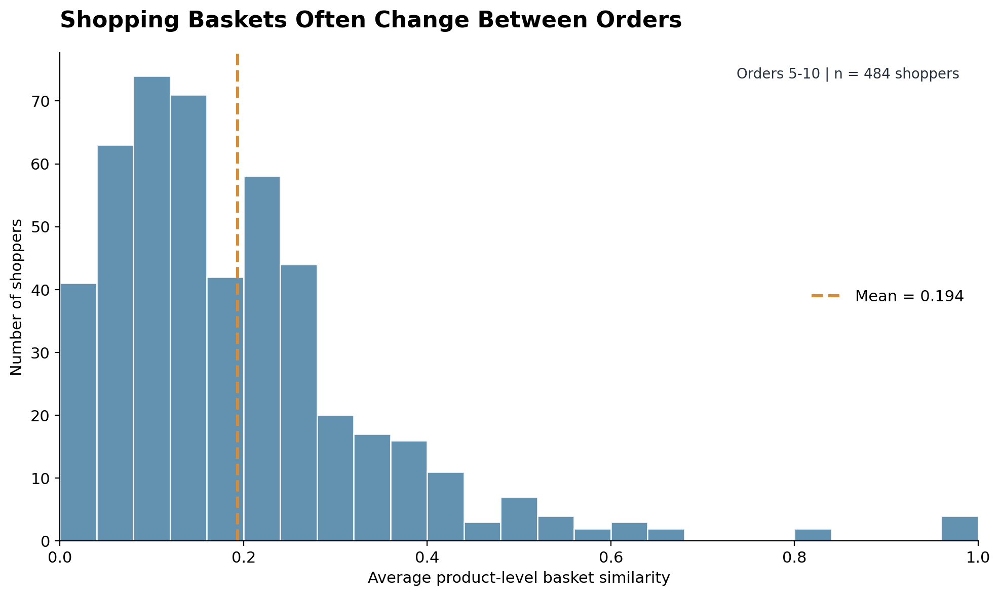
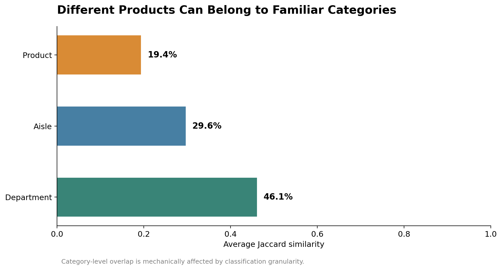
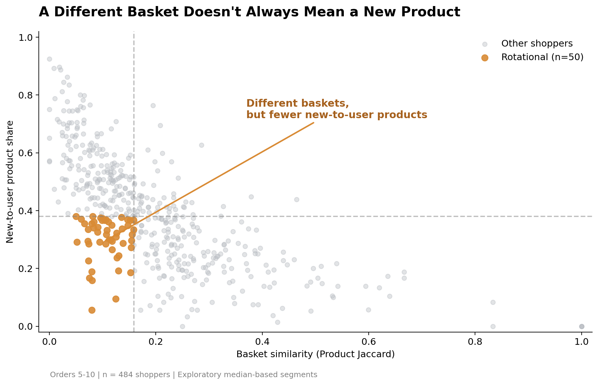
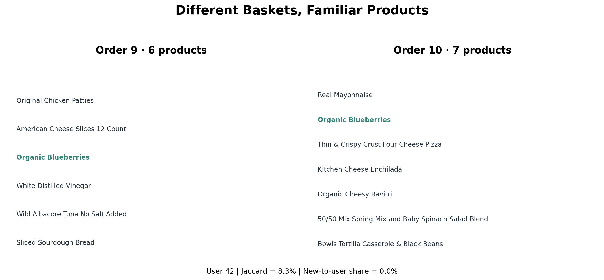
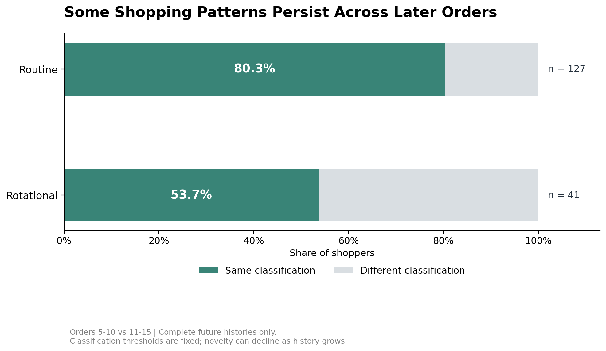

| [Home](https://hanklin999.github.io/tswd-portfolio/) | [Data Visualization Examples](dataviz-examples) | [Critique by Design](critique-by-design) | [Final Project I](final-project-part-one) | [Final Project II](final-project-part-two) | [Final Project III](final-project-part-three) |

# Final Project I: Initial Proposal

## The Habitual Shopper

> **Online grocery shopping may offer endless choices, but are you really discovering anything new?**

Different baskets do not always mean new discoveries. Shoppers may simply rotate among products they already know.

**Project links:** [Analysis repository](https://github.com/Hanklin999/the-habitual-shopper) | [Part II: Development and Iteration](final-project-part-two)

---

## The Proposal

### Why This Matters

Online stores make thousands of products available, but more choice does not automatically create more exploration. If routine purchasing and discovery are treated as the same behavior, shoppers may receive unhelpful recommendations and product teams may misread what a changing basket means.

### Audience and Reader Goal

The primary audience is product managers and analysts working on online grocery shopping, repeat purchases, and recommendations.

As a reader, I want to understand the difference between **changing a basket** and **discovering products**, so I can recognize routine purchases, save time on them, and make exploration more intentional.

### Main Question

**When shopping baskets change, are consumers actually discovering new products?**

---

## Planned Story

1. **The puzzle:** Grocery shopping is habitual, but consecutive baskets may share fewer products than expected.
2. **The reveal:** Baskets can look different at the product level while remaining familiar at the aisle or department level.
3. **The distinction:** Low overlap between two orders does not necessarily mean the later order contains new-to-history products.
4. **The implication:** Routine replenishment and product discovery should be measured and designed as different shopping needs.

The analysis will compare consecutive baskets with each shopper's longer recorded purchase history. This allows the story to separate basket variation from new-to-history purchasing.

---

## Initial Visualization Sketches

### 1. How Similar Are Consecutive Baskets?

This opening chart introduces the puzzle by showing how much consecutive orders overlap.

### 2. Different Products, Familiar Categories

This comparison asks whether apparently different baskets still belong to familiar aisles and departments.

### 3. Basket Change Is Not the Same as Discovery

This is the central chart. It compares basket overlap with the share of products that are new to a shopper's recorded history.

The Shopper 42 example will make the distinction concrete by showing two different baskets made entirely from familiar products.

### 4. Do the Patterns Continue?

The final chart will test whether the observed patterns continue across a later group of orders.

---

## Data and Method

- **Source:** [Instacart Market Basket Analysis](https://www.kaggle.com/competitions/instacart-market-basket-analysis/data)
- **Data:** Anonymized orders, products, aisles, departments, and reorder indicators
- **Basket overlap:** Jaccard similarity between consecutive orders
- **Product discovery proxy:** Share of products not previously observed in the shopper's recorded history
- **Tools:** Python, Pandas, NumPy, and Matplotlib; Tableau or Plotly may be used for final presentation
- **Code and outputs:** [The Habitual Shopper repository](https://github.com/Hanklin999/the-habitual-shopper)

### Important Limits

- New-to-history does not necessarily mean new to the shopper's life.
- Purchase records do not show browsing, search, recommendation exposure, or motivation.
- The initial sample is not random, so results should not be generalized to all shoppers.
- The analysis is descriptive, not causal.

---

## Intended Medium and Call to Action

The final project will be a scroll-driven story on GitHub Pages. Each section will use one main question, one visual, and one takeaway.

> **Automate the routine. Make discovery intentional.**

Shoppers may save time by using subscriptions or saved lists for routine items, then comparing products, stores, or platforms when they genuinely want to explore. Product teams can support this by treating replenishment and discovery as different needs and testing them with different measures.

---

## References

1. Instacart. (2017). *Instacart Market Basket Analysis*. Kaggle. https://www.kaggle.com/datasets/psparks/instacart-market-basket-analysis
2. Berinato, S. (2016). *Good Charts: The HBR Guide to Making Smarter, More Persuasive Data Visualizations*. Harvard Business Review Press.

## AI Acknowledgements

I used ChatGPT to help brainstorm the story structure, debug parts of the Python analysis, and revise the organization and wording. I checked the numerical results against the Instacart data and made the final decisions about the topic, analysis, visualizations, and interpretation.
