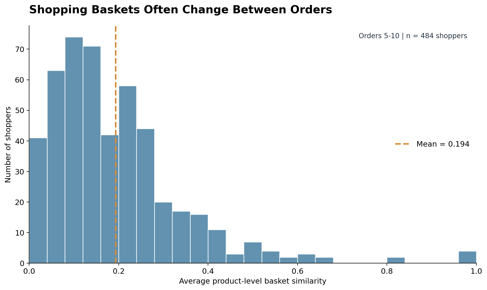
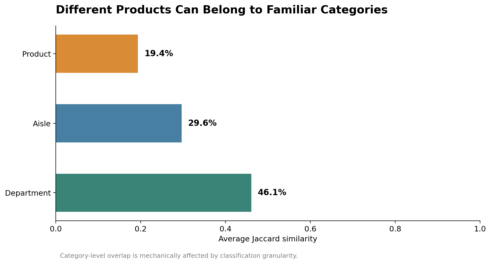
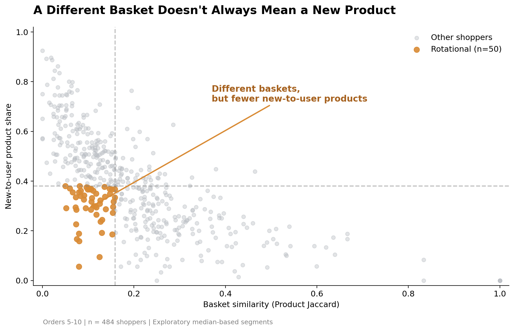
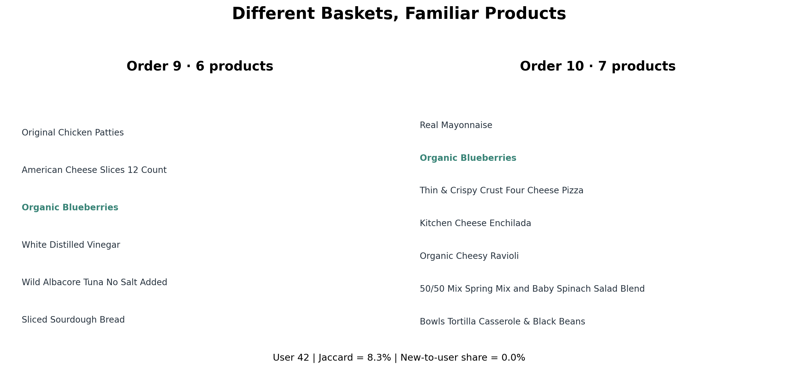
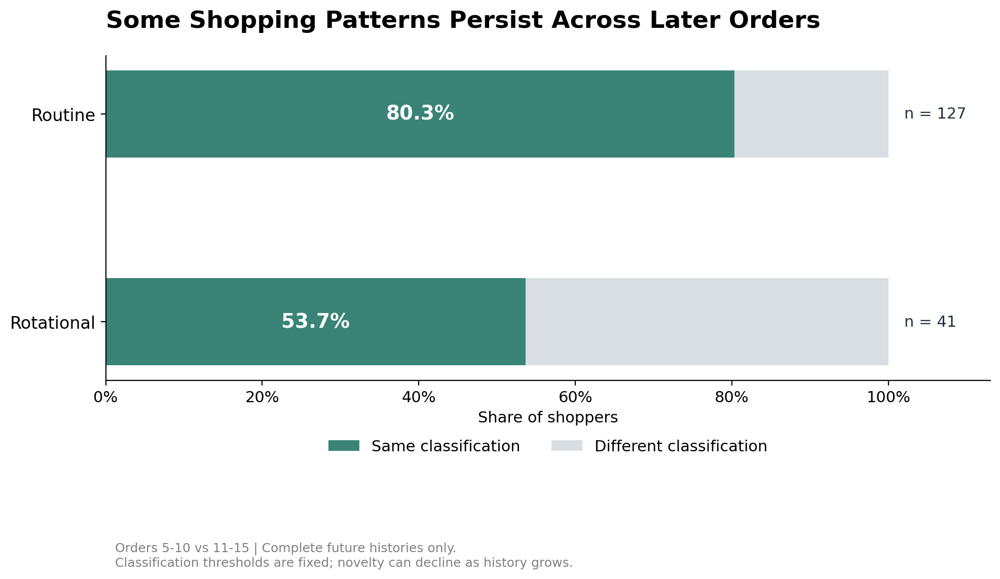

| [Home](https://hanklin999.github.io/tswd-portfolio/) | [Data Visualization Examples](dataviz-examples) | [Critique by Design](critique-by-design) | [Final Project I](final-project-part-one) | [Final Project II](final-project-part-two) | [Final Project III](final-project-part-three) |

# Final Project I: Initial Proposal

# The Habitual Shopper
### When Shopping Baskets Change, Are Consumers Really Discovering New Products?

**Target Audience:** E-commerce Product Managers, Product Analysts, and Recommendation System Teams

**Central Message:** A different shopping basket does not necessarily mean a shopper is discovering new products. Understanding shopping habits requires examining both consecutive orders and the shopper's broader purchase history.

---

# Outline

## Project Overview

Online grocery platforms offer consumers thousands of products, yet a changing shopping basket does not necessarily mean that a shopper is discovering something new. A customer might purchase different items on consecutive visits while continuing to rotate among products they have bought before. For e-commerce product managers, this distinction matters: basket variation, repeat purchasing, and product discovery represent different aspects of shopping behavior. Treating them as the same phenomenon may lead to misleading interpretations of how consumers interact with an online marketplace.

This project, **The Habitual Shopper**, explores how grocery shopping baskets change across repeated purchases using the Instacart Market Basket Analysis dataset. By comparing product-level similarity, category-level similarity, and product novelty across individual purchase histories, I aim to show why low basket overlap does not always indicate new-product discovery. The story also investigates whether shopping patterns persist across later orders. Through a four-act narrative, the project will challenge a seemingly intuitive assumption about shopping behavior and demonstrate how more careful measurement could inform product analytics and personalization decisions.

## Story Structure: A Four-Act Narrative

### Act 1 — Setup: Shopping Baskets Often Change Between Orders

**Guiding Question: How similar are a customer's consecutive grocery orders?**

Grocery shopping is commonly associated with repetitive purchasing. Customers routinely need familiar essentials, which might suggest that their shopping baskets should remain relatively consistent across orders.

However, when similarity is measured using the Jaccard Index, a different picture emerges. In the exploratory sample of 484 shoppers with complete purchase histories for orders 5–10, average user-level product similarity is only **19.4%**.

This opening visualization will show the distribution of basket similarity and highlight how frequently customers change the specific combinations of products they purchase.

**Intended Audience Reaction:** If grocery shopping is so routine, why do consecutive baskets have relatively little product overlap?

**Transition:** Does a different product basket necessarily mean a different type of shopping trip?

### Act 2 — Reveal: Different Products Can Belong to Familiar Categories

**Guiding Question: Are shoppers changing their preferences, or simply purchasing different products within familiar categories?**

Product-level similarity alone may not fully capture the structure of grocery shopping. A shopper may purchase different products across consecutive orders while remaining within many of the same aisles and departments.

The analysis compares consecutive baskets at three levels of product classification:

- **Product-level Jaccard Similarity:** 19.4%
- **Aisle-level Jaccard Similarity:** 29.6%
- **Department-level Jaccard Similarity:** 46.1%

These findings suggest that shopping baskets can appear more consistent when examined through broader product categories.

However, higher category-level overlap is also expected because broader classifications contain more products. It should not automatically be interpreted as evidence of stable preferences or consumer loyalty.

**Intended Audience Reaction:** Perhaps customers are changing products more frequently than they are changing the broader types of products they purchase.

**Transition:** But even when the specific products change, are shoppers actually purchasing unfamiliar products?

### Act 3 — Tension: A Different Basket Does Not Always Mean Discovery

**Guiding Question: Are customers discovering new products, or rotating among products they have purchased before?**

This act introduces the central distinction of the project.

Basket similarity measures overlap between **two consecutive orders**, while product novelty measures whether products in an order have appeared anywhere in the shopper's **previously recorded purchase history**.

These two metrics can therefore describe very different behaviors.

For example, a customer could purchase a completely different set of products compared with their preceding order, even though every product has been purchased at some earlier point.

To investigate this distinction, I compare shoppers using their purchase behavior during orders 5–10. Exploratory median-based thresholds classify shoppers into four descriptive groups:

| Shopping Pattern | Basket Similarity | Product Novelty | Interpretation |
|---|---|---|---|
| Routine | High | Low | Similar baskets with previously purchased products |
| Rotational | Low | Low | Different baskets composed largely of familiar products |
| New-to-user | Low | High | Different baskets containing more products new to recorded history |
| Mixed | High | High | Similar baskets that also contain newly observed products |

The most interesting group is **Rotational Shoppers**.

In the exploratory sample, **50 of 484 shoppers (10.3%)** fall into this low-similarity, low-novelty quadrant.

These categories are constructed using sample thresholds rather than discovered through a clustering algorithm. They are intended to support interpretation, not to represent validated customer segments.

#### A Real Example: Shopper 42

One shopper provides a particularly intuitive illustration.

Across two consecutive orders:

- **Order 9:** Six products
- **Order 10:** Seven products
- **Common product:** Organic Blueberries
- **Product Jaccard Similarity:** 8.3%
- **New-to-history share in Order 10:** 0%

Although the two orders contain substantially different products, all seven items in Order 10 had appeared previously in the shopper's recorded purchase history.

This example demonstrates the project's central insight:

**A nearly complete change in the shopping basket does not necessarily represent new-to-user product purchasing.**

**Intended Audience Reaction:** A different basket can be made entirely of familiar products. Basket variation and product novelty are not the same phenomenon.

**Transition:** Is this pattern only visible in a few orders, or does it continue later in a shopper's purchase history?

### Act 4 — Resolution: Some Shopping Patterns Persist Across Later Orders

**Guiding Question: Do the observed shopping patterns continue across subsequent purchases?**

The final act explores whether the shopping patterns identified during orders 5–10 persist in later purchase histories.

The original exploratory classifications are applied to a second observation window covering orders 11–15.

Among **323 shoppers with complete histories for both windows**, the results show:

- **Routine:** 80.3% of initially Routine shoppers (n = 127) retain that classification.
- **Rotational:** 53.7% of initially Rotational shoppers (n = 41) retain that classification.

These findings suggest that some descriptive shopping patterns continue across several purchases, although their stability differs.

The results must be interpreted carefully. Product novelty tends to decline as observed purchase histories become longer, and shoppers with complete later-order records are not necessarily representative of all shoppers in the original sample.

The story will close by connecting this insight to product management.

**Final Takeaway:** Product managers should distinguish basket variation from new-to-user purchasing when interpreting customer behavior. Purchase history and product-category information can provide additional context for developing personalization hypotheses, although controlled experiments would be necessary to determine whether these approaches improve customer outcomes.

---

## Initial sketches

The following sketches represent my preliminary visual storytelling plan. They were developed using exploratory analysis of Instacart transaction data and are intended to demonstrate the narrative structure, important comparisons, and visual emphasis of the final project.

### Sketch 1 — Shopping Baskets Often Change Between Orders

**Narrative Purpose:** Establish the initial puzzle by showing that consecutive baskets frequently have relatively low product overlap.

The histogram displays the distribution of average product-level Jaccard similarity across the 484 shoppers in the fixed-window sample.

The central annotation will emphasize the **19.4% average similarity**.

This visualization introduces the question that motivates the rest of the story: why do shopping baskets change so much?

### Sketch 2 — Different Products, Familiar Categories

**Narrative Purpose:** Reveal how basket similarity changes when products are grouped into broader categories.

The horizontal bar chart compares average Jaccard similarity across products, aisles, and departments.

It highlights the progression from **19.4% product similarity** to **29.6% aisle similarity** and **46.1% department similarity**.

The final version will explain the role of category granularity to prevent readers from interpreting the comparison as direct evidence of consumer loyalty.

### Sketch 3 — A Different Basket Does Not Always Mean Discovery

**Narrative Purpose:** Deliver the central tension of the story by separating basket similarity from product novelty.

The scatter plot compares each shopper's average product-level Jaccard similarity with their average new-to-history product share.

The **50 Rotational Shoppers** are highlighted to draw attention to customers who have low consecutive-basket similarity but also low product novelty.

This visualization serves as the primary turning point in the narrative.

#### Supporting Example — Shopper 42

**Narrative Purpose:** Translate an abstract statistical relationship into a concrete shopping example.

The side-by-side product lists show two actual consecutive orders from Shopper 42. Only one product overlaps, yet all seven products in the second order had been purchased previously.

This example helps readers understand why a shopper can change almost everything in their immediate basket without purchasing any products new to their recorded history.

### Sketch 4 — Some Shopping Patterns Persist Across Later Orders

**Narrative Purpose:** Provide a resolution by comparing whether exploratory classifications continue in later orders.

The visualization uses two 100% stacked bars to compare the proportion of Routine and Rotational shoppers retaining their original classifications in orders 11–15.

Among eligible validation shoppers, **80.3% of Routine shoppers and 53.7% of Rotational shoppers** retain their classifications.

This provides an accessible conclusion without overstating the permanence of consumer behavior.

---

# The data

## Primary Data Source

The primary data source for this project is the publicly available **Instacart Market Basket Analysis** dataset, released as part of a 2017 Kaggle competition. The dataset provides anonymized grocery purchase histories, including the products purchased in individual orders, the chronological sequence of orders, and information about whether products had appeared previously in a shopper's recorded history. Product metadata also identifies each product's aisle and department, allowing the same shopping basket to be examined at different levels of detail. I have obtained the dataset and performed an initial exploratory analysis in Python, confirming that it contains the variables needed to investigate consecutive-basket similarity, category-level overlap, and new-to-history purchasing.

The project uses five related datasets: `orders.csv`, `order_products__prior.csv`, `products.csv`, `aisles.csv`, and `departments.csv`. These tables are joined using order, product, aisle, and department identifiers. The initial analysis uses the first 1,000 eligible shoppers by user ID rather than a random sample. From these records, 484 shoppers with complete prior-order histories for orders 5–10 are included in the main fixed-window analysis, and 323 shoppers have sufficient records for a later comparison covering orders 11–15. In the next stage, I plan to refine the presentation of the results, test the sensitivity of the descriptive patterns to basket-size differences, and clearly communicate the limitations created by sample selection and varying lengths of observed shopping histories.

## Data Sources

| Name | URL | Description |
|---|---|---|
| Instacart Market Basket Analysis | [Kaggle Dataset](https://www.kaggle.com/datasets/psparks/instacart-market-basket-analysis) | Public dataset containing anonymized grocery purchase histories and product metadata |
| Orders | [Dataset Download](https://www.kaggle.com/datasets/psparks/instacart-market-basket-analysis) | Shopper IDs, order IDs, order sequence, and time between orders |
| Order Products (Prior) | [Dataset Download](https://www.kaggle.com/datasets/psparks/instacart-market-basket-analysis) | Products purchased in recorded prior orders and reordered indicators |
| Products, Aisles, and Departments | [Dataset Download](https://www.kaggle.com/datasets/psparks/instacart-market-basket-analysis) | Product names and category classifications |

**Exploratory analysis and code:** [The Habitual Shopper — GitHub Repository](https://github.com/Hanklin999/the-habitual-shopper)

## Analytical Approach

**1. Basket Similarity**

Product-level similarity is measured using the Jaccard Index:

**Jaccard Similarity = Number of Products in Both Baskets / Number of Unique Products Across Both Baskets**

The calculation is also applied separately to aisle and department sets to compare shopping baskets at different levels of product classification.

**2. Product Novelty**

Product novelty is measured as the proportion of products in an order marked `reordered = 0`, indicating that they had not previously appeared in that shopper's recorded purchasing history.

This should be interpreted as **new-to-recorded-history purchasing**, not necessarily intentional discovery, recommendation exposure, or a product being newly available in the marketplace.

**3. Behavioral Patterns**

I use average basket similarity and average product novelty during orders 5–10 to construct four exploratory shopper classifications based on sample median thresholds. These classifications are compared with behavior during orders 11–15 to investigate descriptive persistence.

## Data Limitations

The dataset contains transaction histories but does not include browsing activity, search behavior, recommendation impressions, or the motivations behind purchasing decisions. Therefore, the analysis cannot identify whether a shopper intentionally discovered a product or whether a recommendation influenced a purchase.

In addition, the initial sample is not randomly selected, product novelty depends on observed purchase-history length, and broader category classifications mechanically increase opportunities for basket overlap. The later-window analysis also includes only shoppers with sufficiently long observed histories.

These limitations will be communicated explicitly throughout the final story. The project's conclusions will remain descriptive rather than causal.

---

# Method and medium

I plan to present the final project as an **interactive, scroll-driven data story**, with **GitHub Pages** as the primary publishing platform.

Python, Pandas, and NumPy will be used for data cleaning, transformation, and exploratory analysis. The preliminary sketches were created using Matplotlib. For the final project, I plan to develop polished, annotated visualizations using **Tableau and/or Plotly**, integrating them into a web-based narrative.

The presentation will follow the four-act structure described above. Each section will introduce a specific question, present a focused visualization, and connect the findings to the next part of the story. The real purchase-history example will help bridge the gap between statistical measures and intuitive consumer behavior.

The final experience is intended for e-commerce product managers and analysts who may not have a technical background in similarity metrics. The emphasis will therefore be on clear visual comparisons, concise annotations, and a coherent narrative rather than a standalone dashboard.

---

## References

1. Instacart. (2017). *Instacart Market Basket Analysis*. Kaggle. https://www.kaggle.com/competitions/instacart-market-basket-analysis/data
2. Berinato, S. (2016). *Good Charts: The HBR Guide to Making Smarter, More Persuasive Data Visualizations*. Harvard Business Review Press.
3. Original exploratory analysis and visualization sketches developed for the CMU Telling Stories with Data course using the Instacart dataset.

---

## AI acknowledgements

I used ChatGPT as a learning and development assistant during the preparation of this project. Its assistance included brainstorming and refining the story structure, developing and debugging Python code for data preparation and exploratory analysis, interpreting analytical results and limitations, and revising the wording and organization of the proposal.

I reviewed the analytical outputs against the Instacart transaction data, selected the research direction and visualizations, and evaluated the interpretations and limitations. The numerical findings and shopping basket examples presented here are based on the actual dataset rather than simulated or AI-generated observations.