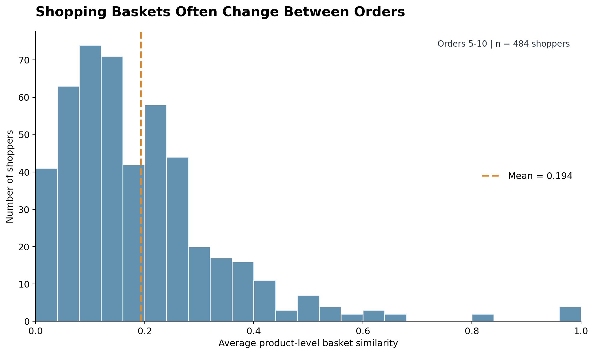
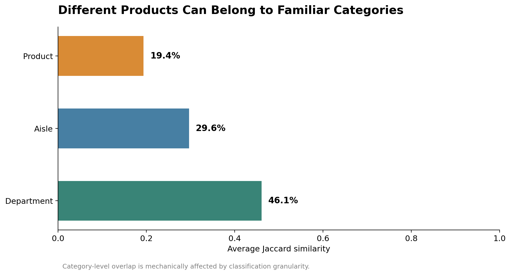
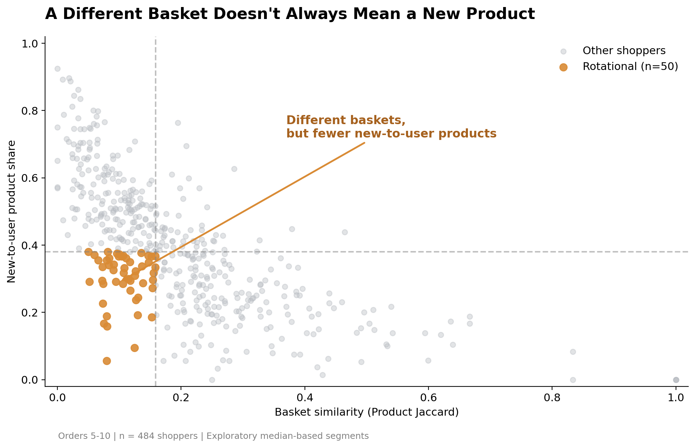
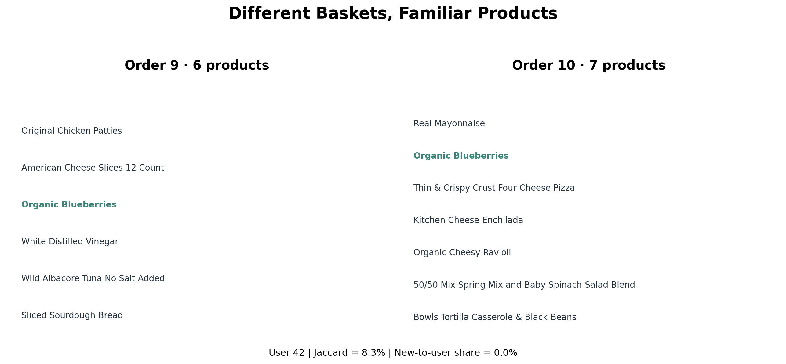
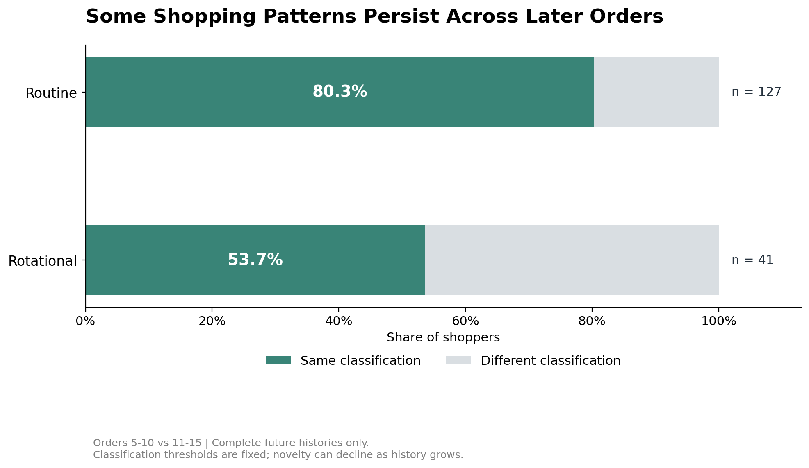

| [Home](https://hanklin999.github.io/tswd-portfolio/) | [Data Visualization Examples](dataviz-examples) | [Critique by Design](critique-by-design) | [Final Project I](final-project-part-one) | [Final Project II](final-project-part-two) | [Final Project III](final-project-part-three) |

# Final Project II: Development and Iteration

## The Habitual Shopper

> **Online grocery shopping may offer endless choices, but are you really discovering anything new?**

**Project links:** [Part I: Initial Proposal](final-project-part-one) | [Analysis repository](https://github.com/Hanklin999/the-habitual-shopper)

---

## How the Story Developed

Part I began with a broad question about whether online shopping encourages discovery. The analysis led to a more specific distinction:

> **A changing basket is not necessarily a discovery basket.**

Basket overlap compares two consecutive orders. Product novelty looks farther back and asks whether an item has appeared anywhere in the shopper's recorded history. The Part II story is organized around this difference.

The analysis uses the first 1,000 eligible shoppers by user ID. The main fixed-window sample contains **484 shoppers** with complete records for orders 5-10. A later comparison uses **323 shoppers** with complete records for orders 11-15.

---

# Wireframes and Storyboards

The final story is planned as four connected sections. Each section asks one question, presents one main visual, and ends with a short transition.

## Act 1: The Puzzle

### Shopping Baskets Often Change

**Question:** How similar are a shopper's consecutive orders?

Among the 484 shoppers in the fixed-window sample, average product-level Jaccard similarity is **19.4%**. Consecutive baskets therefore share fewer products than a simple idea of habitual grocery shopping might suggest.

**Design plan:** Keep the histogram simple, label the mean directly, and explain Jaccard similarity in one sentence.

**Transition:** If baskets change this much, are shoppers exploring unfamiliar products?

## Act 2: The Reveal

### Different Products Can Still Belong to Familiar Categories

**Question:** Does a different product basket represent a different type of shopping trip?

Average overlap rises as the level of classification becomes broader:

- Products: **19.4%**
- Aisles: **29.6%**
- Departments: **46.1%**

This does not prove loyalty or stable preferences. Broader categories naturally create more opportunities for overlap. It shows that the answer depends partly on what level is being measured.

**Design plan:** Use direct labels instead of a legend and add a note that broader categories are easier to match.

**Transition:** Even if the categories are familiar, are the specific products new to the shopper?

## Act 3: The Main Insight

### A Different Basket Does Not Always Mean Discovery

**Question:** Are shoppers buying new-to-history products or rearranging familiar ones?

Using exploratory median thresholds, I organize shoppers into four descriptive patterns: Routine, Rotational, New-to-user, and Mixed. **50 of 484 shoppers (10.3%)** fall into the Rotational group: their consecutive baskets have relatively low overlap, but their products are mostly familiar from earlier orders.

These labels are storytelling tools, not permanent or validated customer types.

**Design plan:** Emphasize the Rotational quadrant and mute the remaining observations. Define both axes in plain language.

### One Shopper Makes the Difference Clear

Shopper 42 purchased six products in Order 9 and seven in Order 10. Only Organic Blueberries appeared in both orders, producing **8.3% overlap**. However, every product in Order 10 had appeared earlier in the shopper's recorded history. The basket changed, but it contained **0% new-to-history products**.

**Design plan:** Use the example immediately after the scatter plot so readers can connect the abstract measures to a real pair of orders.

**Transition:** Is this rotational behavior temporary, or does it continue?

## Act 4: The Check

### Some Patterns Continue Across Later Orders

**Question:** Do the descriptive patterns persist in a later observation period?

Among shoppers with complete records for both periods:

- **80.3%** of initially Routine shoppers remain Routine (n = 127).
- **53.7%** of initially Rotational shoppers remain Rotational (n = 41).

Routine behavior appears more stable than rotational behavior in this selected subset. The result should be interpreted cautiously because novelty changes as purchase history accumulates and the later-window group is not a random sample.

**Design plan:** Use two 100% stacked bars with direct percentage labels and a visible note about the selected validation subset.

---

# User Research

## Target Audience and Recruitment

The primary audience is product managers and analysts who work with online shopping, recommendations, or repeat purchasing. The story should also remain understandable to regular online grocery shoppers.

For feedback, I plan to speak with three types of readers:

1. A frequent online shopper who can judge whether the story feels relevant.
2. A reader with product, business, or analytics experience who can evaluate the implications.
3. A reader without a data background who can identify confusing terms or charts.

No names or personally identifiable information will be reported.

## Research Goals and Interview Script

| Goal | Questions to Ask |
|---|---|
| Test the opening | After reading the title and opening, what do you think the story will show? |
| Check the central distinction | In your own words, what is the difference between basket change and product discovery? |
| Test chart comprehension | What do you notice first in each chart? What is confusing or missing? |
| Evaluate the Shopper 42 example | Does the example make the main point clearer? Why or why not? |
| Check relevance | Does this story change how you think about your own online shopping? |
| Test the ending | What action or conclusion do you take away from the final section? |
| Find weak points | Where did you lose interest, slow down, or want more evidence? |

The interview should begin without explaining the intended conclusion. After the participant reads the draft, I will ask the questions above and request a short summary of the story in their own words.

## Interview Findings

**Status:** User interviews have not yet been documented. This section should be completed with actual feedback before submission; findings should not be invented.

| Question or task | Interview 1 | Interview 2 | Interview 3 |
|---|---|---|---|
| Expected story after the opening | To be completed | To be completed | To be completed |
| Explanation of basket change vs. discovery | To be completed | To be completed | To be completed |
| Most confusing chart or term | To be completed | To be completed | To be completed |
| Reaction to Shopper 42 | To be completed | To be completed | To be completed |
| Main takeaway or action | To be completed | To be completed | To be completed |

---

# Identified Changes for Part III

The following revisions come from the current analysis and self-review. Interview-based changes should be added after the research sessions.

| Current observation | Planned change for Part III |
|---|---|
| Jaccard similarity is unfamiliar to many readers. | Introduce it as “shared products divided by all unique products” before using the technical name. |
| The four segment labels may look more definitive than they are. | Call them descriptive patterns and show that the thresholds are exploratory. |
| The category comparison can be mistaken for evidence of loyalty. | Add a note that broader categories naturally create more overlap. |
| The scatter plot is the most complex visual. | Define both axes directly and reveal the Rotational quadrant only after the base chart is understood. |
| Percentages in the later-window analysis may appear population-wide. | Display the subgroup sizes and the selected-sample limitation beside the chart. |
| The story currently speaks mainly to product teams. | Add a short shopper takeaway: automate routine purchases and make exploration intentional. |

## Part III Priorities

1. Complete and document user interviews.
2. Revise the story based on repeated feedback, not one isolated comment.
3. Reduce explanatory text around each chart.
4. Improve annotations, type size, color contrast, and mobile readability.
5. Build the final scroll-driven page and test all links and visualizations.

---

## References

1. Instacart. (2017). *Instacart Market Basket Analysis*. Kaggle. https://www.kaggle.com/competitions/instacart-market-basket-analysis/data
2. Berinato, S. (2016). *Good Charts: The HBR Guide to Making Smarter, More Persuasive Data Visualizations*. Harvard Business Review Press.
3. Analysis code and generated outputs: https://github.com/Hanklin999/the-habitual-shopper

## AI Acknowledgements

I used ChatGPT to help reorganize the Part II draft, revise wording, and debug the Python analysis. I verified the reported values against the generated analysis outputs. User-research findings will be based only on actual interviews and will not be generated by AI.
